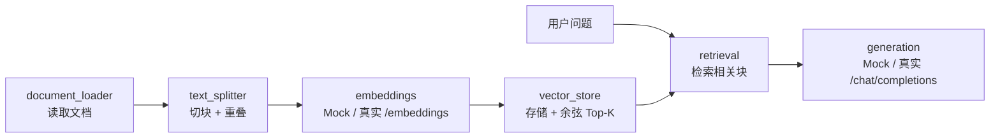

# 02 · RAG Knowledge Base（rag-knowledge-base）

作品集第 02 个正式项目：完整走通 **RAG（Retrieval-Augmented Generation，检索增强生成）** 基础流程，
并展示干净、可测试、可替换的工程架构。

## 当前开发阶段

**第二阶段（已完成）：接入真实模型服务。** 新增 OpenAI 兼容的真实 Embedding 与 Generation 客户端
（已验证目标：智谱 GLM 开放平台），通过 `.env` 配置，与 Mock 模式一键切换。
第一阶段（Mock 架构）的全部能力与测试原样保留：离线、免费、零密钥可运行。

## RAG 工作流程



一次完整调用：`ingest()` 把文档切块并向量化入库；`ask(question)` 先检索最相关的块，
再把「问题 + 检索到的上下文」交给生成模块。

## 模块职责

| 模块 | 职责 | 实现 |
| --- | --- | --- |
| `document_loader.py` | `Document` 结构 + 加载接口 | `TextLoader`（UTF-8 文本文件，离线） |
| `text_splitter.py` | `Chunk` 结构 + 切分接口 | `FixedSizeSplitter`（固定窗口 + overlap） |
| `embeddings.py` | `EmbeddingClient` 接口 | `MockEmbeddingClient`（bigram 哈希）；`OpenAICompatibleEmbeddingClient`（真实 `/embeddings`） |
| `vector_store.py` | `VectorRecord`/`SearchHit` + 存储接口 | `InMemoryVectorStore`（纯 Python 余弦 Top-K） |
| `retrieval.py` | `Retriever`：查询 → 相关块 | 组合 embedder + store |
| `generation.py` | `GenerationClient` 接口 | `MockGenerationClient`；`OpenAICompatibleGenerationClient`（真实 `/chat/completions` + 防编造 Prompt） |
| `config.py` | 5+1 个环境变量 → `Settings`；real 模式必填校验；密钥掩码 | 新增于第二阶段 |
| `http_transport.py` | 共享 HTTP 层：httpx 异常/状态码 → `Rag*` 异常 | 新增于第二阶段 |
| `factory.py` | 按 `RAG_MODE` 创建 Mock 或真实客户端 | 新增于第二阶段 |
| `pipeline.py` | 端到端流程 | 所有组件 Protocol 注入，可整体替换 |

## 环境准备

- Python >= 3.11（本机默认 3.14，见 `.python-version`；CI 矩阵为 3.11 + 3.14）
- Mock 模式：零密钥、离线、免费；real 模式：需要你自己的智谱 API Key（本地 `.env` 自填）

## 安装

```bash
cd projects/02-rag-knowledge-base
py -3.14 -m venv .venv                  # 本机 Git Bash 的 python 是 MSYS2 版，请用 py 启动器
source .venv/Scripts/activate           # PowerShell: .venv\Scripts\Activate.ps1
python -m pip install -e ".[dev]"
```

## 运行方式一：Mock 模式（默认，无需密钥）

```bash
python -m rag_knowledge_base
```

不设置 `RAG_MODE` 时默认 Mock：内置示例文本 → 切分 → Mock 向量 → 内存检索 → Mock 回答，全程离线。

## 运行方式二：real 模式（智谱 GLM，OpenAI 兼容）

1. 在**本机**把 `.env.example` 复制为 `.env`；
2. 把 `RAG_MODE` 改为 `real`，取消注释并填写：
   - `LLM_BASE_URL=https://open.bigmodel.cn/api/paas/v4/`（官方公开文档值）
   - `LLM_API_KEY=<你的智谱 API Key>`（只写在这里，绝不提交、绝不发给别人）
   - `EMBEDDING_MODEL=<官方向量模型名，如 embedding-3>`
   - `GENERATION_MODEL=<官方对话模型名，以官方列表为准>`
3. 运行同一条命令：

```bash
python -m rag_knowledge_base
```

接口细节（2026-11 官方文档确认）：认证为 `Authorization: Bearer <API Key>`；
向量端点 `POST {base_url}/embeddings`（请求 `{model, input}`，响应取 `data[0].embedding`，
embedding-3 默认 2048 维、可选 256/512/1024/2048）；对话端点 `POST {base_url}/chat/completions`
（响应取 `choices[0].message.content`）。
**API Key 只从本地 `.env` 或环境变量读取；本项目代码、测试、文档中没有任何真实密钥。**

## Prompt 正确性约定

真实 Generation Client 的 System Prompt 明确要求模型：

1. 优先且仅依据检索到的资料回答；
2. 资料中没有足够信息时必须明确说明，不要猜测；
3. 不要编造资料中不存在的内容。

（有单元测试断言 Prompt 包含上述约束、检索块与用户问题都进入请求体。）

## 测试与检查

```bash
python -m pytest -q
ruff check .
```

真实客户端的单元测试全部使用 `httpx.MockTransport`，**不联网、不产生任何费用**；
覆盖配置缺失、认证失败（401）、限流（429）、服务端错误（5xx）、超时、连接失败、响应格式异常。

## 配置变量

| 变量 | 必填 | 默认 | 说明 |
| --- | --- | --- | --- |
| `RAG_MODE` | 否 | `mock` | `mock` 或 `real` |
| `LLM_BASE_URL` | real 必填 | 空 | OpenAI 兼容服务地址；智谱为 `https://open.bigmodel.cn/api/paas/v4/`（公开文档值，非密钥） |
| `LLM_API_KEY` | real 必填 | 空 | 密钥；只放本地 `.env` 或环境变量，绝不进 Git、绝不发给别人 |
| `EMBEDDING_MODEL` | real 必填 | 空 | 向量模型名；以官方模型列表为准，项目不预置 |
| `GENERATION_MODEL` | real 必填 | 空 | 对话模型名；以官方模型列表为准，项目不预置 |
| `LLM_TIMEOUT_SECONDS` | 否 | `30` | 正整数秒，对 Embedding 与 Generation 请求同时生效 |

real 模式缺少任何必填项会得到列出缺失变量名的友好错误，不会发出网络请求。

## 依赖选型记录

- **python-dotenv**：读取本地 `.env`；轻量、事实标准、活跃维护、免费。
- **httpx**（第二阶段新增）：与 01 项目 `llm-api-assistant` 保持同一 HTTP 方案，工程风格一致；
  轻量且维护活跃、原生超时与连接池、异常层级清晰（TimeoutException/TransportError）便于统一映射错误。
  备选对比：标准库 `urllib` 无连接池、错误处理繁琐；`requests` 仅同步。
  已写入 `pyproject.toml`，克隆后 `pip install -e ".[dev]"` 即可复现。

## 安全说明

- `.env`、真实密钥、缓存、数据库文件一律不进 Git（`.gitignore` 已实测拦截）；
- 日志与配置摘要中的密钥一律掩码显示（如 `su***56`），有专门测试断言明文密钥不出现在 stdout/stderr/日志；
- 真实客户端的异常消息只含状态码与配置项名称，不包含密钥与响应体内容；
- 本仓库的代码、README、`.env.example` 不包含任何真实密钥（Base URL 为公开文档值）。

## 当前限制

1. `InMemoryVectorStore` 不持久化，进程退出即丢失（第三阶段计划）；
2. 只支持 `.txt` 单文件加载；无中文分词优化；
3. 真实调用的端到端验证由用户在本地完成（自动化测试绝不调用付费 API）；
4. 每次问答都重新向量化查询，无缓存。

## 后续路线（第三阶段起）

1. 向量持久化（文件或 SQLite/FAISS，选型时先说明理由）；
2. 支持 Markdown/PDF 等更多文档格式与中文分词优化；
3. 检索评估：构造小评测集，量化命中率；
4. 限流/连接失败的自动重试。

## 开发约定

遵循工作区 `docs/project-standards.md`；提交与发布安全流程见 `docs/git-and-release-checklist.md`。
