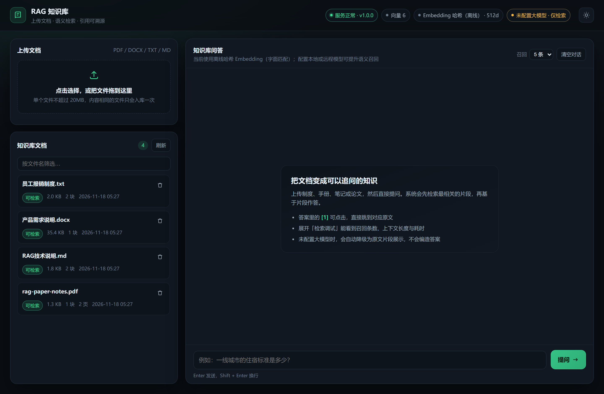
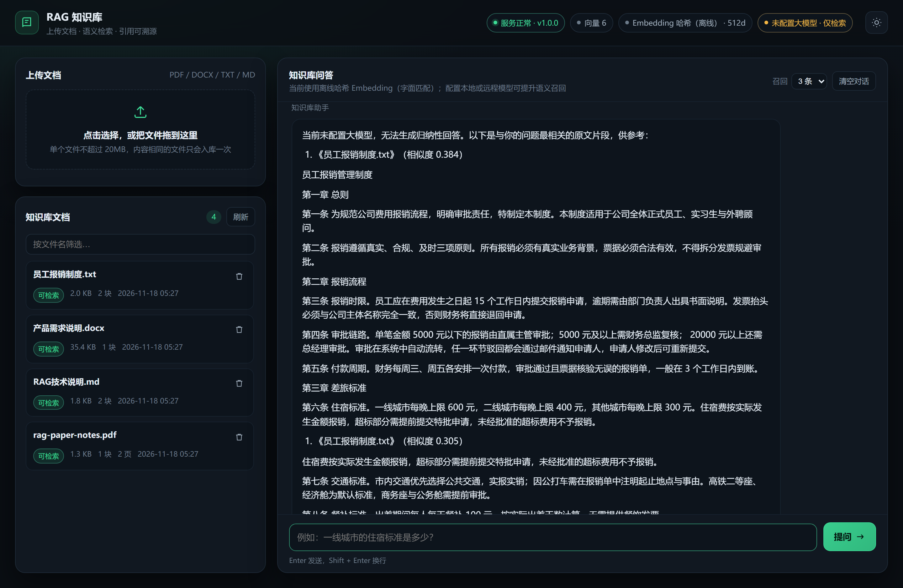
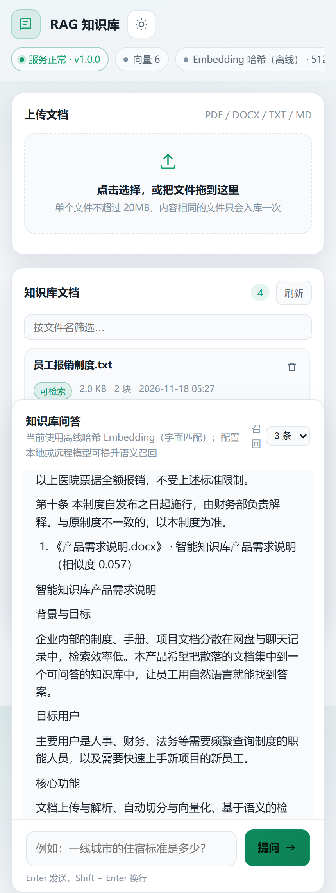

# RAG Knowledge Base（rag-knowledge-base）


基于 **RAG（Retrieval-Augmented Generation，检索增强生成）** 的全栈智能文档知识库：
上传 PDF / DOCX / TXT / Markdown → 解析切块 → 向量化入库 → ChromaDB 检索 → 大模型生成**可溯源引用**的回答。
未配置大模型时自动降级为"原文片段展示"，文档管理与检索功能**完整可用**。

## 核心功能

- 文档上传与解析：四种格式，内容哈希查重（重复上传返回 409），解析失败入库为 failed 并返回 422；
- 段落感知切分：`CHUNK_SIZE` / `CHUNK_OVERLAP` / `MIN_CHUNK_CHARS` 可调；
- 三种 Embedding 方案：哈希（默认，零下载）/ 本地 sentence-transformers / OpenAI 兼容远程 API；
- ChromaDB 持久化向量库（按 Embedding 签名隔离集合，切换方案不串库）；
- SQLite 持久化（文档、块、查询日志；可选 PostgreSQL）；
- 检索调试接口 + 问答接口：引用带 `[n]《文档名》第 X 页 · 章节` 与相似度，附 debug 统计；
- 原生前端：上传、文档管理、检索面板、问答（含深色模式与移动端适配）。

## 技术栈

Python 3.14 · FastAPI · Uvicorn · SQLAlchemy 2 · Pydantic v2 · ChromaDB · httpx · pypdf / python-docx
· 原生 HTML/CSS/JS 前端（无框架）。全部依赖见 `requirements*.txt`，均为免费方案。

## 架构

```mermaid
flowchart TB
    subgraph 入库
        U[POST /api/documents/upload] --> SEC[类型白名单 / 大小流式限制<br/>UUID 落盘]
        SEC --> P[解析器注册表<br/>pdf / docx / txt / md]
        P --> C[chunker 切分]
        C --> E[Embedding Provider<br/>hashing / 本地ST / 远程API]
        E --> V[ChromaDB 持久化]
        P --> DB[(SQLite<br/>documents / chunks / query_log)]
    end
    subgraph 问答
        Q[POST /api/knowledge/query] --> R[向量化检索 Top-K]
        V --> R
        R --> CT[上下文组装<br/>[n] 引用标注 + 长度预算]
        CT --> L{LLM 已配置?}
        L -- 是 --> G[大模型生成<br/>反幻觉 Prompt]
        L -- 否 / 调用失败 --> EX[降级：原文片段 extractive]
    end
```

## 目录结构

```text
app/            FastAPI 应用：api/ 路由 · core/ 配置与安全 · rag/ 解析切块向量化
                · models/ ORM · schemas/ 响应模型 · services/ 业务服务 · vector_store/
frontend/       原生前端（index.html / app.js / styles.css）
tests/          166 项测试（API 端到端 + 服务层 + 单元，tmp_path 隔离）
docs/           README 截图
samples/        演示文档（供上传体验）
scripts/        可选开发脚本（生成样例、Playwright 截图）
data/           运行时数据（SQLite / Chroma / 上传文件），已被 .gitignore 排除
requirements*.txt   依赖清单：运行时 / dev / 可选本地模型 / 可选 PostgreSQL
```

## 环境要求

- **Python 3.14**（项目在 3.14.3 / Windows 上开发与实测；CI 在 ubuntu 3.14 上验证；其他版本未验证）
- 无任何付费依赖；**没有 API Key 也能完整运行**（见下文"无 API Key 模式"）

## 安装

```bash
py -3.14 -m venv .venv                    # Windows；本机 Git Bash 的 python 是 MSYS2 版，用 py 启动器
source .venv/Scripts/activate             # PowerShell: .venv\Scripts\Activate.ps1
python -m pip install -r requirements-dev.txt   # 已包含运行时依赖 requirements.txt
```

可选增强（按需，默认不装）：

```bash
python -m pip install -r requirements-local-embedding.txt   # 本地 sentence-transformers（含 torch，体积大）
python -m pip install -r requirements-postgres.txt          # PostgreSQL 驱动
```

## 启动

```bash
python -m uvicorn app.main:app --host 127.0.0.1 --port 8000
# 开发热重载：python -m uvicorn app.main:app --reload --port 8000
```

- **前端页面**：<http://127.0.0.1:8000/>
- **API 文档**：<http://127.0.0.1:8000/docs>（Swagger UI）；另有 `/redoc` 与 `/openapi.json`
- **健康检查**：GET `/api/health`（数据库 / 向量库 / Embedding / LLM 配置状态一览）

## 主要接口

| 方法与路径 | 说明 |
| --- | --- |
| `POST /api/documents/upload` | 上传并解析（multipart `file`），完成校验→查重→切分→向量化 |
| `GET /api/documents` | 文档列表（分页 + 文件名搜索） |
| `GET /api/documents/{id}` | 文档详情（含切分块） |
| `DELETE /api/documents/{id}` | 删除文档及其向量 |
| `POST /api/knowledge/query` | RAG 问答（`question`、可选 `top_k`、`document_ids`） |
| `GET /api/knowledge/search` | 只检索不生成（调试用） |
| `GET /api/health` | 健康检查与组件状态 |

## 文档上传支持

- 格式白名单：`.pdf`、`.docx`、`.txt`、`.md`、`.markdown`（`ALLOWED_EXTENSIONS` 可调）；
- 大小限制：默认 20MB（`UPLOAD_MAX_MB`），流式校验，超限返回 413；
- 服务端以 UUID 落盘（不信任客户端文件名），相同内容按哈希查重返回 409。

## RAG 工作流程

1. **入库**：上传 → 安全校验 → 哈希查重 → 解析（含页码）→ 段落感知切分 → 批量向量化 → 写入 Chroma 与 SQLite；
2. **问答**：问题向量化 → Top-K 检索（支持按文档过滤、相似度阈值）→ 上下文按 `[n]` 编号并做长度预算
   → 大模型按反幻觉规则作答并标注引用 → 记录查询日志；
3. **降级链**：未配置 LLM 或调用失败 → 返回 `answer_mode=extractive`（最相关原文片段）；无命中 → 明确
   `no_context` 提示，绝不让模型凭空作答。

## Embedding 与向量存储

| 方案 | 说明 |
| --- | --- |
| `hashing`（默认） | 字符 n-gram 哈希 + 归一化，512 维；零下载、零费用，足以演示检索排序 |
| `sentence-transformers`（可选） | 本地模型（默认 `BAAI/bge-small-zh-v1.5`），真实语义相似度；需额外安装且首次下载权重 |
| `openai`（可选） | OpenAI 兼容远程 Embedding API（三项配置齐全才启用） |

向量库：ChromaDB 持久化于 `data/chroma`；集合名含 Embedding 签名（如 `knowledge_chunks_hashing-char-ngram-512`），
切换 Embedding 方案不会污染旧向量。

## 无 API Key 模式（默认）

不配置任何密钥即可启动：上传、解析、检索、引用展示全部可用；问答返回
`answer_mode=extractive` 的原文片段，并在 `notice` 中如实说明"未配置大模型"。
健康检查会显示 `llm.configured=false`。

## LLM 配置（可选）

复制 `.env.example` 为 `.env`，三项齐全才启用（缺任一项自动降级，不报错、不调用）：

```env
LLM_BASE_URL=https://open.bigmodel.cn/api/paas/v4
LLM_API_KEY=replace-me            # 在本地 .env 中填入你的真实 Key；绝不提交、绝不发给别人
LLM_MODEL=glm-4-flash             # 以智谱官方模型列表为准
```

兼容任何 OpenAI 兼容服务（`/chat/completions`）。LLM 超时/断连/鉴权失败会**自动降级**为
extractive 并在 `notice` 中说明原因；密钥使用 `SecretStr` 处理，日志与摘要只出现掩码。

## 配置项（节选，完整见 `.env.example` 与 `app/core/config.py`）

| 变量 | 默认 | 说明 |
| --- | --- | --- |
| `ENVIRONMENT` / `DEBUG` / `LOG_LEVEL` | development / false / INFO | 应用与日志 |
| `DATA_DIR` | `data` | 上传、SQLite、Chroma 的根目录 |
| `UPLOAD_MAX_MB` / `ALLOWED_EXTENSIONS` | 20 / 五种格式 | 上传限制 |
| `CHUNK_SIZE` / `CHUNK_OVERLAP` / `MIN_CHUNK_CHARS` | 500 / 80 / 20 | 切分 |
| `EMBEDDING_PROVIDER` / `EMBEDDING_DIMENSION` | hashing / 512 | 向量化方案 |
| `VECTOR_STORE_PROVIDER` / `CHROMA_DIR` / `CHROMA_COLLECTION` | chroma / data/chroma | 向量库 |
| `RETRIEVAL_TOP_K` / `RETRIEVAL_SCORE_THRESHOLD` / `MAX_CONTEXT_CHARS` | 5 / 0.0 / 4000 | 检索与上下文 |
| `LLM_BASE_URL` / `LLM_API_KEY` / `LLM_MODEL` / `LLM_TIMEOUT_SECONDS` | 空（降级模式） | 大模型，三项齐全才启用 |

## 测试

```bash
python -m pytest -q          # 166 项：API 端到端 + 服务层 + 单元（含标记为 slow 的真实 Chroma 持久化用例）
ruff check .                 # 代码检查
python -m pytest -q --cov=app  # 可选：覆盖率（pytest-cov 已在 dev 依赖中）
```

测试使用 `tmp_path` 隔离的临时 SQLite 与 Chroma，**绝不读写仓库的 `data/`，也绝不调用真实付费 API**
（LLM/远程 Embedding 一律用测试桩）。

## CI

GitHub Actions（`.github/workflows/ci.yml`）在 push 与 pull_request 时运行：
安装 `requirements-dev.txt` → `ruff check .` → 全量 `pytest` → 启动服务并请求 `/api/health` 冒烟验证。
Python 版本 3.14，与 `.python-version` 一致，启用 pip 缓存。

## 截图

| 概览 | 深色问答 | 移动端 |
| --- | --- | --- |
|  |  |  |

更多截图见 `docs/screenshots/`。

## 当前安全限制

- **没有用户认证**：设计定位是本地/内网工具，**不建议直接暴露到公网**；部署到不受信环境前请自行加鉴权与访问控制；
- 上传文件以 UUID 落盘、路径穿越有防御、大小流式限制，但仍请只在可信环境开放；
- 密钥只从 `.env` 或环境变量读取（`SecretStr`），日志与启动摘要只显示掩码；`.env`、`data/` 均被 `.gitignore` 排除；
- 哈希 Embedding 只保证"共享字词多则更靠前"，不是真实语义检索——需要语义质量请切换本地或远程 Embedding。

## 后续改进方向

1. 用户认证与多租户隔离；
2. Dockerfile 与一键部署；
3. 检索质量评估集与 Rerank；
4. LLM 流式输出；
5. 失败文档的重新解析入口。

## 版本演进

- v0.2（提交 `89220ed`）：纯库式 RAG 流水线（`src/rag_knowledge_base`，CLI 演示，72 项测试）；
- v1.0（当前工作区）：升级为 FastAPI 全栈应用（Web 前端 + REST API + 持久化），旧版流水线完整保留在
  提交 `89220ed` 中可随时查阅。

## 开发约定

遵循工作区 `docs/project-standards.md`；提交与发布安全流程见 `docs/git-and-release-checklist.md`。
